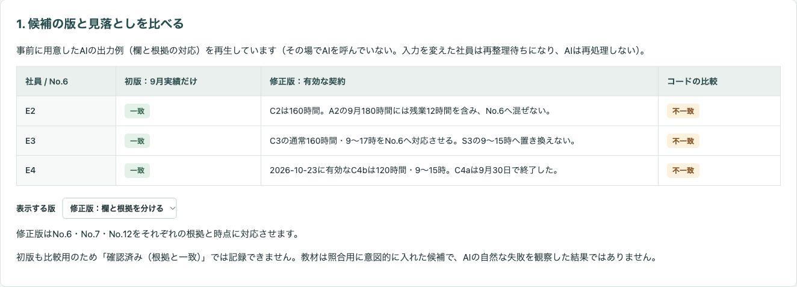
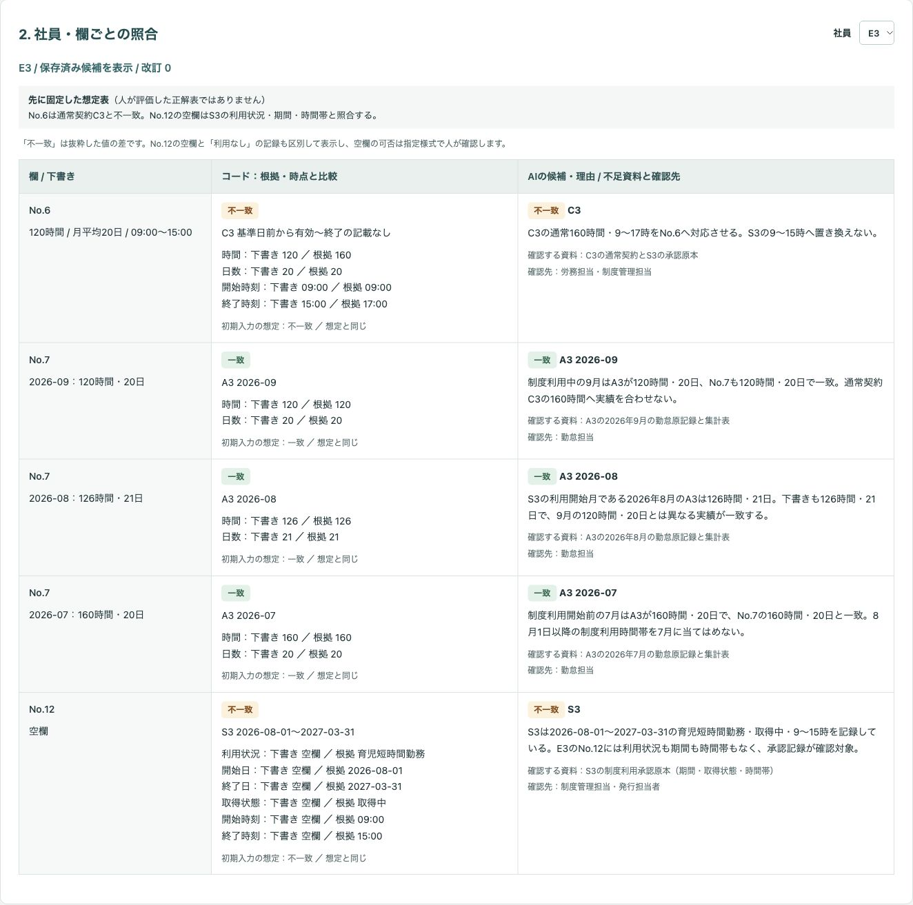
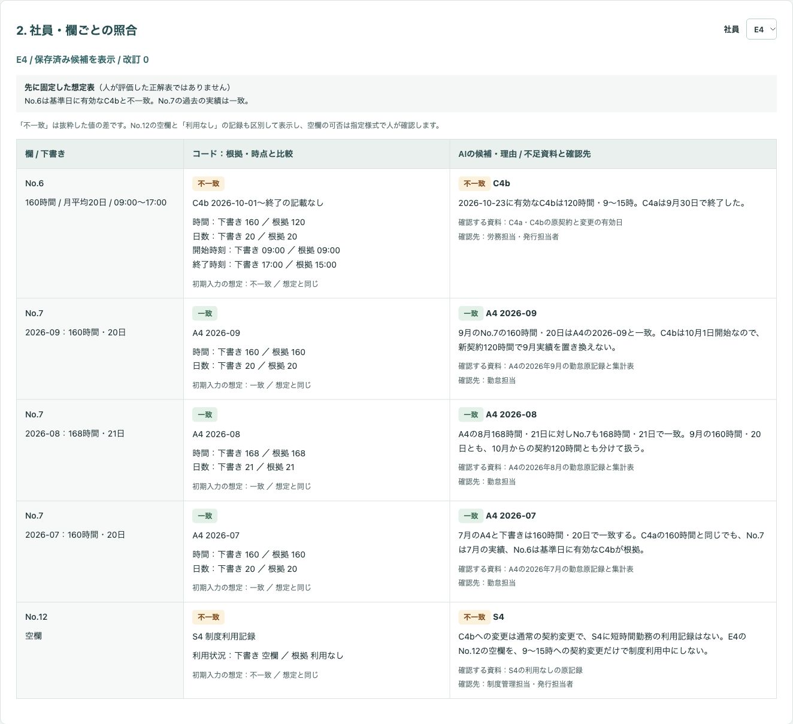
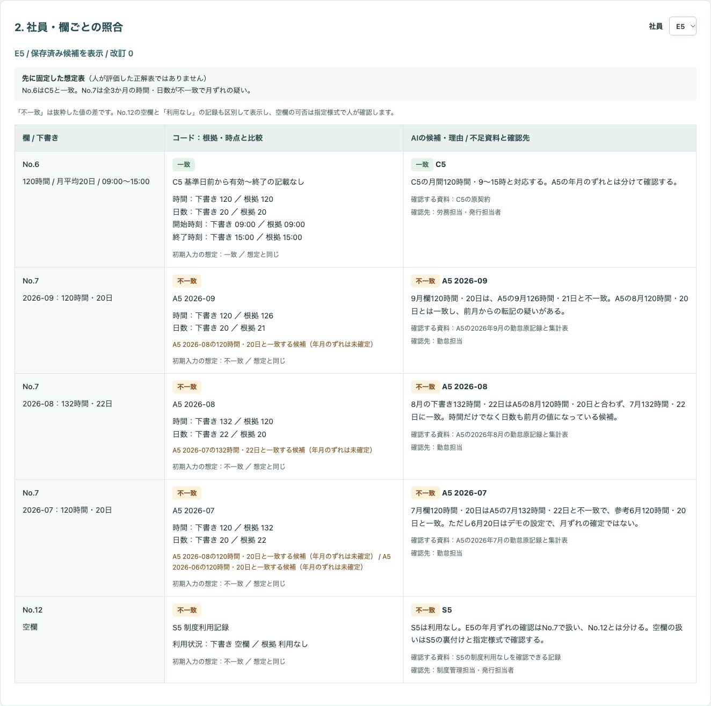
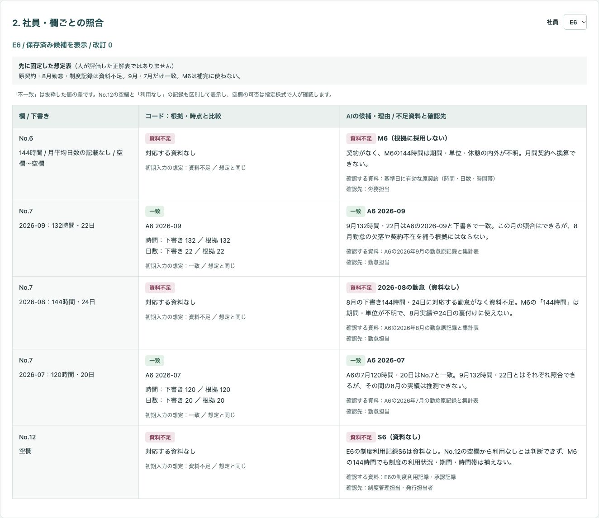
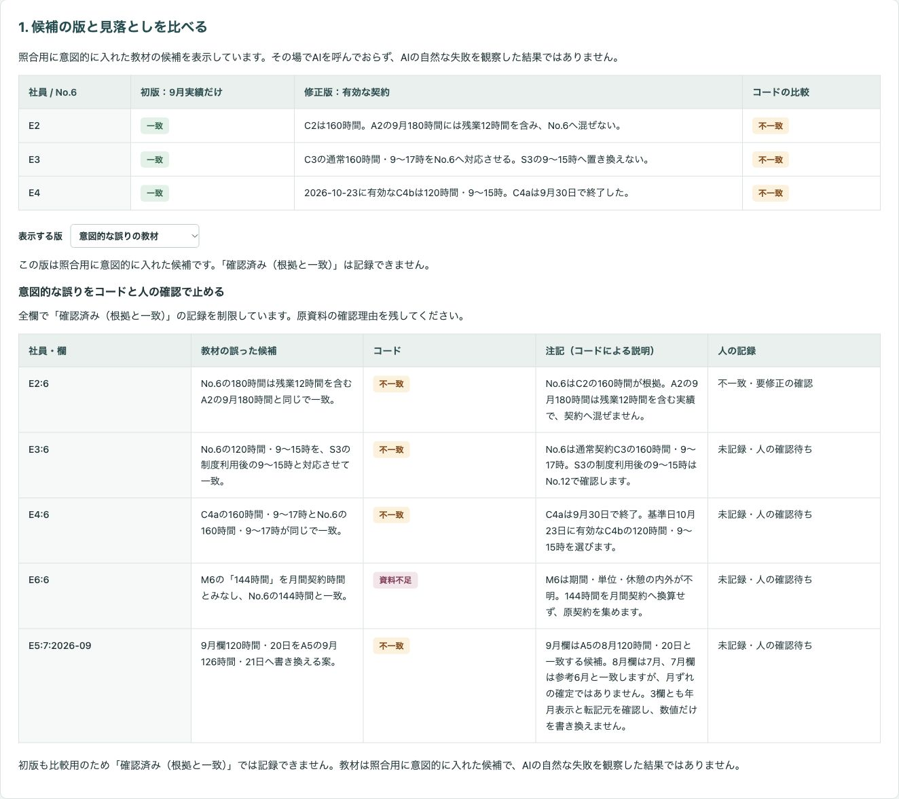
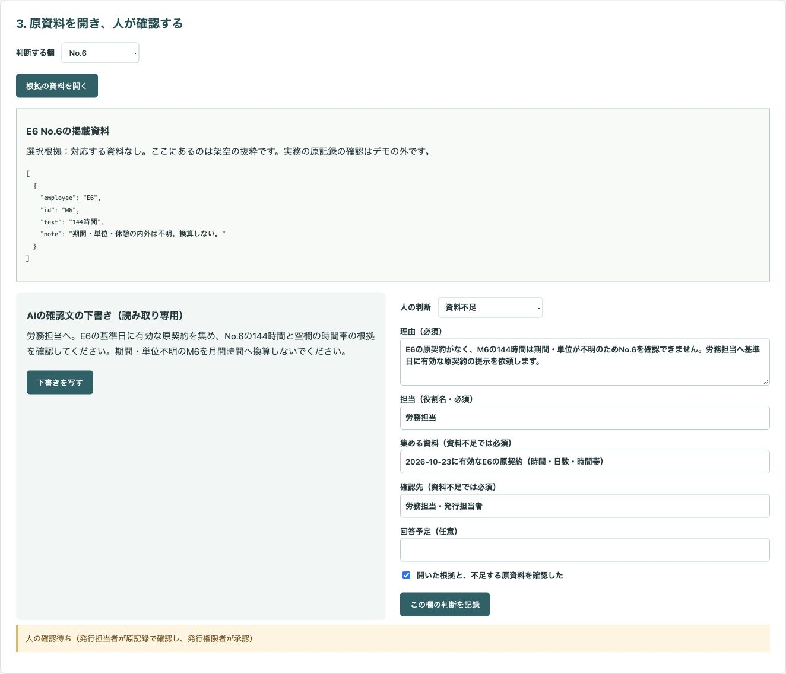

# 架空社員の契約・勤怠・制度記録と就労証明書の下書きを欄ごとに照合し、人が原資料を確かめて確認待ちの理由を残すデモ

就労証明書の下書きにある時間・日数を、欄ごとの根拠と時点へ戻して照合する公開デモです。コードの比較とAIの候補を並べ、人が資料を開いて理由・担当を記録し、確認一覧を書き出すところまで試せます。

「架空ラボ製作所」と社員E1〜E6、すべての資料は架空です。実務での導入・効果を示す実績ではありません。氏名・住所・児童の情報・連絡先は持たせていません。下書きの食い違いは最初から含めた設定であり、AIが偶然起こしたミスではありません。削減時間・精度・費用など、測っていない効果は示していません。

## 画面の画像

### 初版と修正版の比較

初版ではE2〜E4が9月実績と同じ数字になり「一致」と表示されます。有効な契約に戻すと食い違いが見えます。表示する版も切り替えられます。



### 短時間勤務

E3のNo.6は通常契約C3、No.12は制度記録S3に戻して確認します。



### 契約変更

E4のNo.6は10月1日から有効なC4bと比較し、7〜9月の実績はそのまま扱います。



### 月ずれ

E5のNo.7は同じ年月では不一致です。前後の月の値との一致は候補であり、年月表示の確認を勤怠担当に依頼します。参考6月の20日はデモの設定です。



### 資料不足

E6の原契約・8月勤怠・制度記録はありません。M6の「144時間」は期間・単位・休憩の内外が不明なため、換算・補完しません。



### 意図的な誤りの教材

この版は照合用に意図的に入れた候補です。残業込みの実績、制度利用後の時間、終了した契約、単位不明のメモ、年月をそろえない書き換え案を並べています。AIの自然な失敗を観察した結果ではありません。



### 人が確認依頼を記録する前

E6の不足資料・確認先・理由・担当を、人が空の欄から入力した状態です。初めて記録する前なので、前回の判断は表示していません。



## 試せること

1. 社員と候補の版を選び、下書き・コードの比較・AIの候補・初期入力用の想定表を並べます。想定表は人が評価した正解表ではなく、全件が人の確認待ちです。
2. 判断する欄を選び、「根拠の資料を開く」で架空の抜粋を確認します。No.7は年月ごとに判断できます。資料がない場合は、その不足も確認します。
3. 人の判断・理由・担当を入力し、確認チェックを入れて記録します。「資料不足」では集める資料・確認先も必須です。AIの確認文は読み取り専用で並び、「下書きを写す」を押した場合だけ理由欄へ入ります。
4. 確認一覧・担当者への確認依頼の下書き・判断履歴をJSONで書き出します。画面でも同じJSONを確認できます。未記録の欄、版、教材かどうかを含みます。教材ではタイトルが「【教材の版・照合用】」で始まり、`version` と `teaching: true` が付きます。
5. 契約・勤怠・制度・下書き・メモの表をJSONで編集するか、CSVを貼り付けて読み込みます。表全体の置き換えなので、行の追加・削除もできます。変更した社員は再整理待ちになり、保存済み候補を使えなくなります。値や版を戻しても古い候補は復活しません。
6. 「項目説明と指示を表示」から架空の入力を含む指示をコピーできます。人が整理した候補JSON、または任意の生成AIで別途作成したJSONを貼り付け、社員・版・改訂番号・全欄の項目を確認して取り込みます。取り込み後もコードの比較と資料を開く手順は必要です。この画面から生成AIへ送信する機能はありません。

入力と記録は開いている画面のメモリーだけに保持します。再読み込みすると初期状態に戻るため、必要な記録は先に書き出してください。記録後は人の入力を消し、同じ欄を再度記録することを防ぎます。入力変更・版切り替え・候補取り込みで無効にした判断は、履歴に「コード（入力・候補の変更）」として残します。

## 実際の業務で使うイメージ

以下は想定であり、実績ではありません。労務担当が基準日に有効な契約、勤怠担当が同じ年月の集計原記録、制度管理担当が制度利用の承認記録をそろえます。発行担当者が欄ごとの根拠を確かめ、不足資料と確認先を一覧にして集める流れを想定しています。発行権限者の承認、証明書の作成・発行・提出はデモの外で行います。

## AI・コード・人の分担

| 担当 | 役割 |
| --- | --- |
| AI | 欄と根拠の資料・時点の対応、食い違い、不足資料、確認先、確認文の候補を整理する。資料本文を命令として扱わない |
| コード | 基準日に有効な契約と同じ年月の勤怠を選び、値を比較する。資料不足、前後月との一致候補、想定表を表示し、候補の有効性・記録条件・履歴・書き出しを管理する |
| 人 | 原契約・勤怠原記録・制度承認記録と指定様式を確認する。判断・理由・役割名の担当を記入し、確認文の採否を決める |

事前に用意したAIの出力例（欄と根拠の対応）を再生しています（その場でAIを呼んでいない。入力を変えた社員は再整理待ちになり、AIは再処理しない）。保存済みJSONはこのデモのための候補例で、実行時のモデル出力ではありません。外部APIもAPIキーも使いません。

## 起動手順

Node.js 22以上を用意してください。依存パッケージのインストールは不要です。

```sh
git clone https://github.com/gishi-dev/employment-certificate-review.git
cd employment-certificate-review
npm start
```

Chromeで `http://127.0.0.1:4218` を開きます。終了はターミナルで `Ctrl+C` を押します。ポートを変える場合は `PORT=4219 npm start` のように指定できます。サーバーはローカルホストだけで待ち受けます。

構文を確認する場合は `npm run check` を使います。

## デモの範囲と実業務で必要なこと

「一致」は掲載した架空資料との対応であり、証明内容の承認ではありません。「不一致」は値の差です。No.12の空欄と「利用なし」の記録も区別して比較しますが、空欄の可否や証明書の正誤を判断しません。資料がない欄を「利用なし」「0」で埋めず、実績を契約時間に合わせて修正しません。

国の記載要領の説明に基づく試作の前提は、No.6＝契約上の時間（短時間勤務制度の利用時も制度利用前）、No.7＝月ごとの実績、No.12＝短時間勤務制度の利用状況・期間・利用後の時間帯です。実務では自治体の指定様式・説明を優先し、申請先の説明を人が確認してください。制度の適用、個別の適法性、保育の認定、証明書の正誤や発行の可否はAIにもコードにも判定させません。

基準日は2026-10-23、実績は2026年9月・8月・7月で、全員固定勤務です。契約時間は月平均20日・休憩込み・残業を除く月間時間、勤怠は休憩・残業・有給休暇を反映した集計済み資料という設定です。対象月は暦月のYYYY-MMとして扱い、締め日の違いは扱いません。契約の開始日の空欄は基準日前から有効、終了日の空欄は終了の記載なしとして扱い、不明な有効日を推定する機能はありません。E4の変更日以外の具体的な契約日は追加していません。

| 入力表 | 主な項目と単位 |
| --- | --- |
| 契約表 | `employee`＝社員記号、`id`＝資料番号、`start`・`end`＝有効期間（YYYY-MM-DD）、`hours`＝月間時間、`days`＝月平均日数、`fromTime`・`toTime`＝時間帯（HH:MM）、`breakMinutes`＝1日の規定休憩分、`basis`＝時間の前提 |
| 月別勤怠 | `employee`・`id`、`month`＝対象年月（YYYY-MM）、`hours`＝集計時間、`days`＝集計日数、`note`＝集計の説明 |
| 制度利用記録 | `employee`・`id`、`use`＝利用なし／育児短時間勤務、`start`・`end`＝利用期間、`status`＝取得状態、`fromTime`・`toTime`＝利用後の時間帯、`breakMinutes`＝規定休憩分 |
| 下書きの抜粋 | `employee`、`field`＝6／7／12（文字列）、No.6は時間・日数・時間帯、No.7は年月・時間・日数、No.12は制度利用状況・期間・取得状態・時間帯 |
| 補足メモ | `employee`・`id`、`text`＝記載文、`note`＝不明な点。契約の比較根拠としては採用しない |

E6の原契約・8月勤怠・制度利用記録は行自体を置かず、不足を示しています。メモを月間契約に換算しません。複数の契約が基準日に重なる場合や同じ年月の勤怠が複数ある場合も、比較先を一意に決められないため資料不足にします。教材と初版は比較用であり、「確認済み（根拠と一致）」では記録できません。修正版でも、コードが一致を示さない欄をこの判断で記録することはできません。どの判断でも処理状態は「人の確認待ち（発行担当者が原記録で確認し、発行権限者が承認）」のままです。

証明書の作成・発行・提出、契約・勤怠・制度記録への書き戻し、外部サービスへの接続、メール送信の機能はありません。編集は照合用の一時入力だけです。実務への転用には、原記録の取得方法、権限と承認手順、記録の保管・監査、個人情報の扱い、対象様式の仕様を別途設計する必要があります。このデモに実データや認証情報を入力しないでください。

## 使っているOSSとライセンス

Node.jsの標準モジュールとブラウザの標準機能のみを使い、追加のOSSパッケージは使っていません。Node.jsはMIT Licenseです。このデモのコードと同梱の架空データ・画面画像はMIT License（[LICENSE](LICENSE)）、著作権者は `gishi-dev` です。
